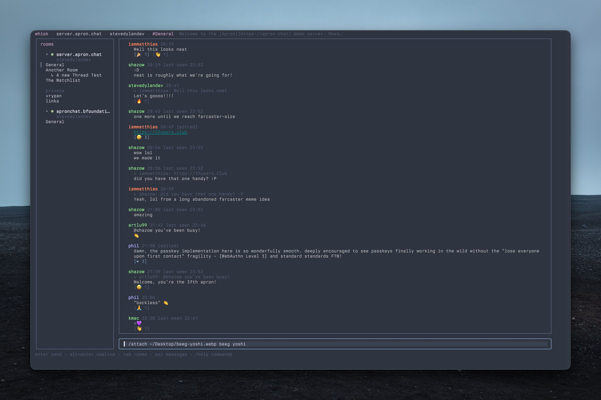

# whisk



>[!WARNING]
>This app is still in early development

A terminal client for the [Apron Chat Protocol](https://apron.chat/), built with
[Charmbracelet Bubble Tea](https://github.com/charmbracelet/bubbletea).

whisk connects to any Apron server over WebSocket and implements the mandatory
core plus the `rooms`, `history`, `edit`, `reactions`, `activity`, `status`,
`embed:upload`, and `command` capabilities. It surfaces transient notices
(command replies, errors, pre-auth welcomes), sends mentions, mutes rooms,
reports idle, and recovers scrollback across reconnects from per-room
checkpoints.

## Install

```sh
go install github.com/stevedylandev/whisk@latest
```

Or build from source:

```sh
git clone https://github.com/stevedylandev/whisk
cd whisk
go install .
```

## Usage

```sh
# walk through setup
whisk

# Or connect with args
whisk --server wss://server.apron.chat/ --name "Your Name"
```

Flags:

| Flag       | Description                                   |
|------------|-----------------------------------------------|
| `--server` | Apron server URL (`wss://`, `ws://`, `https://`, `http://`, or a bare host); adds it if not saved |
| `--name`   | Display name for guest sign-in (that server, or the first saved) |
| `--token`  | Bearer token for token sign-in (that server, or the first saved) |
| `--config` | Config file path (default `~/.config/whisk/config.json`) |
| `--theme`  | Color theme: `dark` (default) or `light`; or set `"theme"` in the config |

>[!NOTE]
>If you signed in to a web client with a passkey, try running `/invite-device NAME` in the web ui to get a token you can use in whisk

### Servers

whisk keeps a list of servers and stays connected to all of them at once. The
sidebar groups rooms under a header per server, showing its connection state
and your name there; moving through the rooms moves between servers.

```json
{
  "servers": [
    { "url": "wss://server.apron.chat/", "name": "Ada", "token": "…" },
    { "url": "wss://chat.example.com/", "token": "…" }
  ]
}
```

### Sign-in

Press `a` in the sidebar to add a server. whisk asks for the URL (`wss://`,
`ws://`, `https://` or `http://`; `https` connects as `wss` and `http` as `ws`,
and a bare host like `chat.example` means `wss://chat.example/`, or
`ws://` for `localhost`). When the root of a server serves its web client
rather than the socket (as `aprond` does), whisk retries at `/ws`, so
`http://localhost:8080` works as-is. Then it presents
a sign-in method chooser listing the schemes the server offers (`esc` cancels):

- **guest** — no account, the server assigns an identity (prompts for a name).
- **token** — a bearer token (pass `--token` or paste it).
- **email** — whisk proposes an email sign-in, you type the code the server
  emails you.
- **external** — whisk opens the server's sign-in page in your browser, and you
  paste back the code it shows.

When a server advertises `signup` (schemes that create an account) separately
from `auth`, the chooser also lists a **create an account** section. A
`guest`/`token` sign-up also covers invite-token flows, where the token creates
a new identity on each use.

Passkey (`webauthn`) sign-in is not implemented: a passkey is bound to the
domain that registered it, so third-party clients sign in with a token issued by
the server's web client instead. This is usually done with a command like `/invite-device NAME`

## Keys

| Context      | Key                         | Action                         |
|--------------|-----------------------------|--------------------------------|
| sign-in      | `tab` / `↑` / `↓`           | move between fields            |
|              | `↑`/`↓` or `k`/`j`          | pick a sign-in method          |
|              | `enter`                     | connect & sign in              |
| rooms        | `↑`/`↓` or `k`/`j`          | move selection (opens joined rooms) |
|              | `enter`                     | focus messages, or join        |
|              | `enter` / `space` on server | collapse/expand (or sign in, when needed) |
|              | `a`                         | add a server                   |
|              | `X`                         | remove the selected server (asks y/n) |
|              | `r` on server               | reconnect a server that gave up |
| messages     | `k`/`j` or `↑`/`↓`          | select previous / next message |
|              | `pgup`/`pgdn`               | page (loads older history)     |
|              | `g` / `G`                   | top / bottom                   |
|              | `r`                         | reply to selected message      |
|              | `o`                         | open a link in the selected message |
|              | `e`                         | edit your selected message     |
|              | `d`                         | delete your selected message (asks y/n) |
|              | `+`                         | pick an emoji reaction; type a name to search |
|              | `i` / `enter`               | focus composer                 |
|              | `N`                         | toggle the notices overlay     |
| composer     | `enter`                     | send                           |
|              | `alt+enter`                 | newline                        |
|              | `tab`                       | complete a path (`/attach`, `/avatar`), else focus rooms |
|              | `esc`                       | cancel a reply or edit, else focus messages |
| any          | `tab`                       | cycle rooms → messages → input |
|              | `r` (disconnected)          | reconnect                      |
|              | `?` (outside the composer)  | open the help popup            |
|              | `ctrl+c`                    | quit                           |

## Commands

Composer text starting with `/` is a command:

| Command                     | Action                                  |
|-----------------------------|-----------------------------------------|
| `/nick NAME`                | change your display name                |
| `/status [VALUE|off]`       | show or set presence (`dnd`, `invisible`, …) |
| `/mute [ROOM|*] [SECONDS|off]` | mute a room (or `*` for everything)  |
| `/join ID`                  | join a room                             |
| `/leave [ID]`               | leave the current (or named) room       |
| `/new [--private] TITLE`    | create a room                           |
| `/thread TITLE`             | start a thread in the current room      |
| `/move ROOM`                | move the selected message to a room     |
| `/react EMOJI`              | react to the selected message           |
| `/emoji [QUERY]`            | insert an emoji into your message       |
| `/attach PATH [caption]`    | attach a file (`~/` expands; `tab` completes the path) |
| `/avatar [PATH]`            | set (or, with no path, clear) your avatar |
| `/help`                     | open the help popup, commands first, with the server's commands |
| `/server CMD [ARGS]`        | send `/CMD ARGS` to the server (alias `/s`) |
| `//text`                    | send a literal message starting with `/`|

Any other `/command` is sent to the server when it advertises the `command`
capability. The commands above are handled by the client, so the client's
version wins when the server has one with the same name; `/server` reaches
the server's (`/server help` shows the server's raw help in the chat). The
help popup lists the server's commands from its `/help` reply and marks
the ones the client hides. Typing `@user_id` of someone in the room mentions them (their name
is shown in place of the id).

## Protocol notes

- The `server` greeting, `auth` (guest/token/email/external, plus `signup`
  schemes), `user`, `message`, `room_list`, `room_join`/`room_leave`/`room_set`,
  `room_update`, `history`, `reactions`, `me`, `activity`, `status`, and
  `command` frames are implemented.
- Message snapshots follow the replay rule (greatest `log_id` wins, tombstones
  win ties); users are merged per §3.3.1 with presence semantics (a carried
  empty value clears the field).
- On a server with `history` but no `rooms`, sign-in sends `history` without
  `room_id` (§4.3) to load the default room's backlog before any live message
  arrives; older pages and reconnect recovery use the same query. A server that
  replies `unsupported` falls back to paging the room a live message reveals.
- Transient notices (messages without `message_id`, e.g. `~private` command
  replies, errors, and pre-auth welcomes) are shown — inline in their room,
  on the sign-in screen, and in the `N` overlay — never installed as snapshots.
- Message save (edit/move/delete) resends `reply_to`, `mentions`, and embeds
  with their `embed_id`s per §4.4; reactions set the caller's complete set per
  §4.7.
- `/attach` and `/avatar` post an `upload` embed and PUT the file content to the
  server-issued `write_url` (§4.8.3).
- On reconnect the store is kept: `room_list` carries a `latest_log_id` filter,
  `left` rooms are dropped, and changed rooms page forward from their
  checkpoints (§4.3.5) — in one room-less `history` stream when several rooms
  changed and the server supports it, otherwise per room. A denied auth (or an unsolicited `denied`) stops auto-reconnect for
  that server and marks it for sign-in in the sidebar; `retry_after` delays the
  next attempt.
- Typing indicators (`activity`) are tracked per room with expiry; presence
  status is shown as a colored dot, `seen` as "last seen …" while offline, and
  roles as badges. The connection reports idle after a few minutes without input
  (§4.5.3).
- Markdown (`format: "markdown"`) renders as CommonMark with raw HTML disabled;
  unknown embed kinds render from `og` or the fallback card, and finished stream
  embeds render their kept `text`.

## Development

```sh
go test ./...
```

See [DEVELOPMENT.md](DEVELOPMENT.md) for the code layout, how the pieces fit
together, and where to make common changes.
